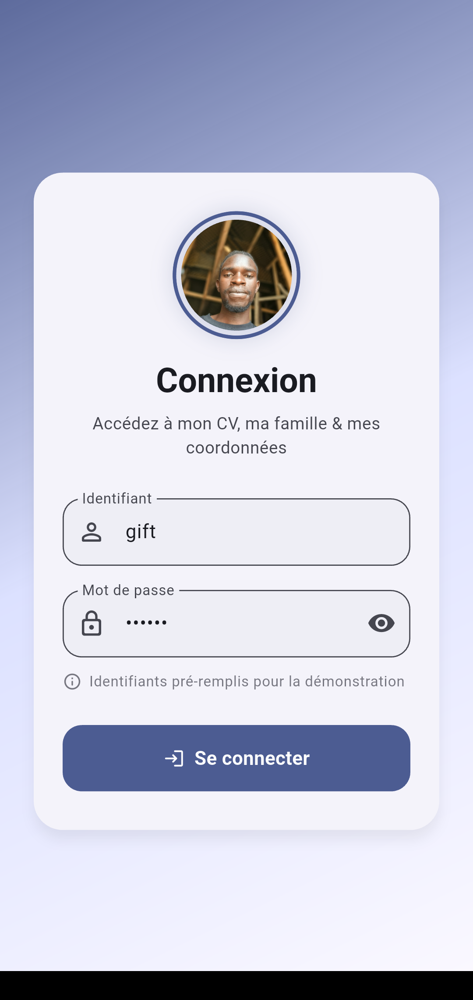
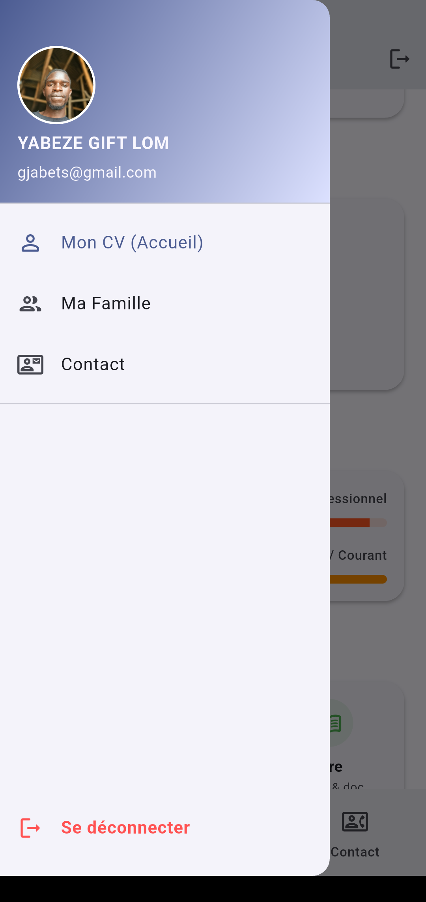
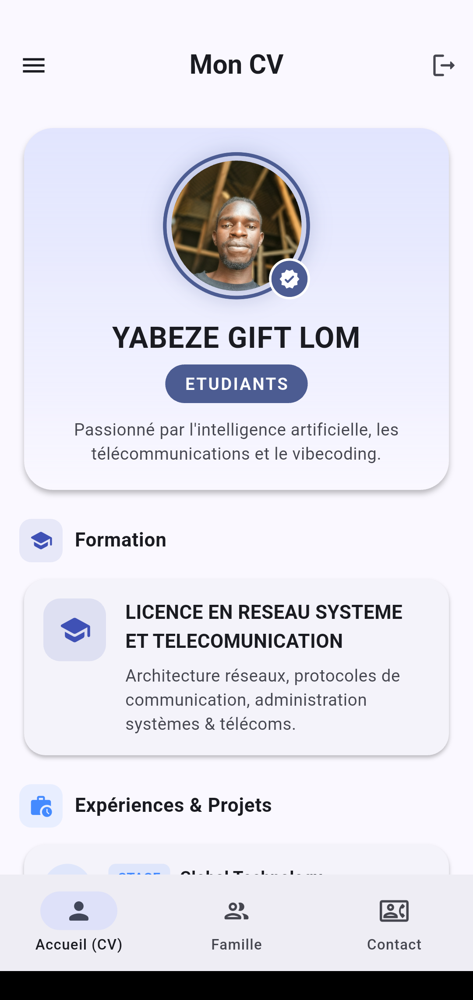
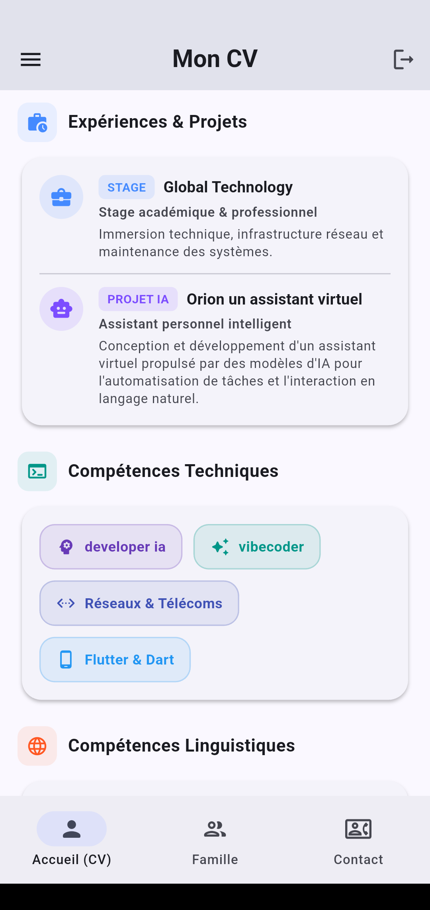
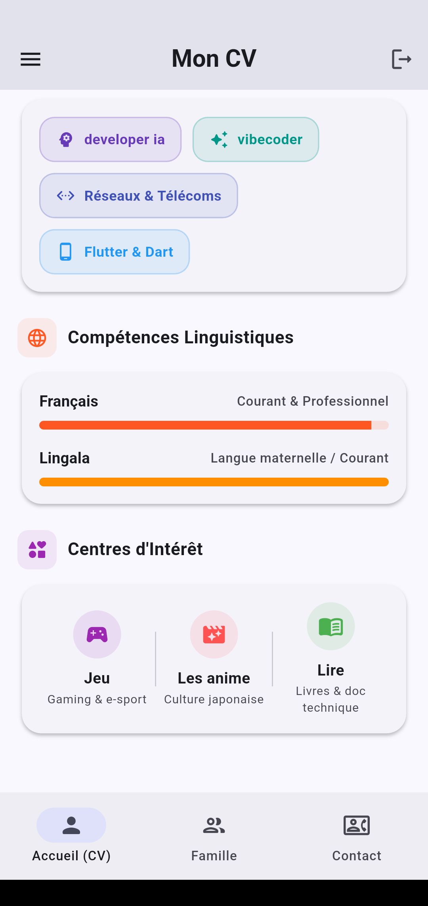
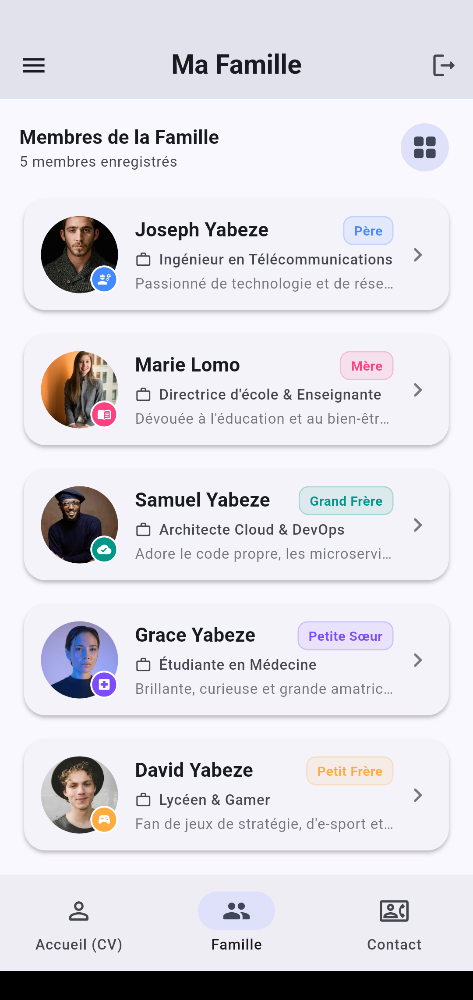
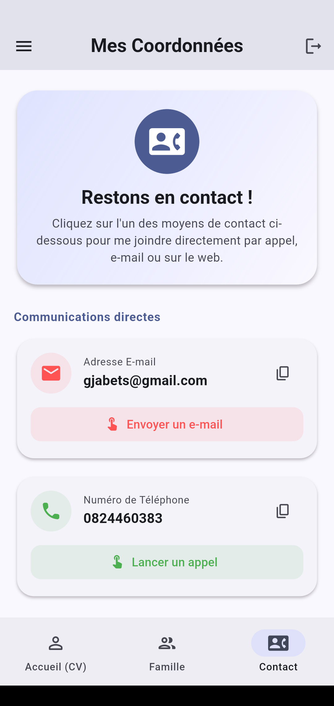
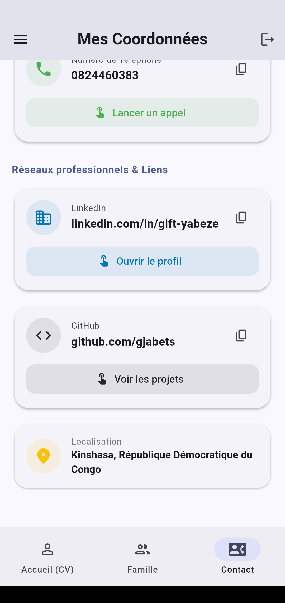

# 📱 Mon CV & Portfolio Mobile - Flutter

[](https://flutter.dev)
[](https://dart.dev)
[](#)

Application mobile développée avec le framework **Flutter** et **Material 3**. Elle présente mon profil professionnel complet, mon parcours universitaire, mes projets récents, ma famille ainsi que mes coordonnées interactives.

---

## 📸 Aperçu de l'Application

### Authentification & Navigation
| Page de Connexion | Menu Latéral (Drawer) |
| :---: | :---: |
|  |  |

### Accueil & CV Complet
| Profil & Formation | Expériences & Projets | Langues & Loisirs |
| :---: | :---: | :---: |
|  |  |  |

### Espace Famille & Coordonnées
| Espace Famille | Contact (Appel & E-mail) | Contact (Réseaux & Localisation) |
| :---: | :---: | :---: |
|  |  |  |

---

## ✨ Fonctionnalités principales

### 1. 🔐 Authentification (`LoginPage`)
* Écran d'accueil avec formulaire de connexion sécurisé.
* Masquage et basculement de la visibilité du mot de passe.
* Validation dynamique des champs.
* Redirection avec retour visuel (`SnackBar`) et déconnexion accessible à tout moment.

### 2. 📄 CV & Parcours complet (`CvPage`)
* **Identité** : Photo de profil, nom complet (**YABEZE GIFT LOM**), statut (**ETUDIANTS**).
* **Formation** : Licence en Réseau, Système et Télécommunication.
* **Expériences & Projets** :
  * Stage chez **Global Technology**.
  * Projet **Orion, un assistant virtuel** (IA & Automatisation).
* **Compétences Techniques** : Developer IA, Vibecoder, Réseaux & Télécoms, Flutter/Dart.
* **Langues** : Français (courant & professionnel) et Lingala (langue maternelle).
* **Centres d'intérêt** : Jeux vidéo, Animes & Mangas, Lecture technique.

### 3. 👨‍👩‍👧‍👦 Espace Famille (`FamilyPage`)
* Présentation des membres de la famille sous forme de cartes élégantes.
* Basculement fluide entre la vue en **Liste** (`ListView`) et la vue en **Grille** (`GridView`).
* Consultation des détails de chaque membre (lien de parenté, profession, bio) via une feuille modale (`ModalBottomSheet`).

### 4. 📞 Coordonnées Interactives (`ContactPage`)
* Intégration de `url_launcher` pour une prise de contact directe :
  * **E-mail** (`gjabets@gmail.com`) ➔ déclenche le client de messagerie.
  * **Téléphone** (`0824460383`) ➔ lance l'application d'appel téléphonique.
  * **LinkedIn** & **GitHub** ➔ redirection directe vers les profils web.
* Boutons de copie rapide dans le presse-papier pour chaque coordonnée.

### 5. 🧭 Navigation Intuitive
* **NavigationBar (Material 3)** pour une transition rapide entre les sections.
* **Drawer latéral** personnalisé avec les informations de l'utilisateur et bouton de déconnexion avec confirmation.

---

## 🛠️ Stack Technique

* **Framework** : [Flutter](https://flutter.dev) (v3.50+)
* **Langage** : [Dart](https://dart.dev) (v3.14+)
* **UI & Design** : Material Design 3
* **Dépendances** :
  * `url_launcher` : Ouverture des protocoles `tel:`, `mailto:` et `https:`
  * `cupertino_icons` : Icônes complémentaires

---

## 📂 Structure du Projet

```text
lib/
├── main.dart                      # Point d'entrée & configuration du thème
├── models/
│   └── family_member.dart         # Modèle de données pour les membres de la famille
└── screens/
    ├── login_screen.dart          # Écran de connexion
    ├── main_navigation_screen.dart# Scaffold principal (Drawer + BottomNav)
    ├── cv_screen.dart             # Page de présentation du CV
    ├── family_screen.dart         # Page de la famille (List & Grid)
    └── contact_screen.dart        # Page de contact interactif
```

---

## 🚀 Installation & Lancement

### Prérequis
* [Flutter SDK](https://docs.flutter.dev/get-started/install) installé et configuré.
* Un appareil Android connecté (ou un émulateur / Chrome).

### Étapes

1. **Cloner le dépôt :**
   ```bash
   git clone https://github.com/gjabets/cv_flutter_vabeze_gift_lomo.git
   cd cv_flutter_vabeze_gift_lomo
   ```

2. **Installer les dépendances :**
   ```bash
   flutter pub get
   ```

3. **Lancer l'application :**
   ```bash
   flutter run
   ```

*(Pour tester sur le Web ou sur ordinateur : `flutter run -d chrome`)*

---

## 👤 Auteur

**Yabeze Gift Lom**
* **Email** : [gjabets@gmail.com](mailto:gjabets@gmail.com)
* **GitHub** : [@gjabets](https://github.com/gjabets)
* **LinkedIn** : [Gift Yabeze](https://www.linkedin.com/in/gift-yabeze)
